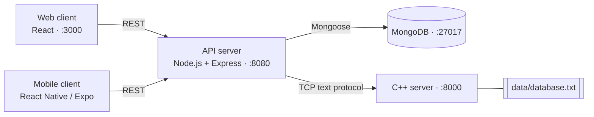

# Bites

A full-stack food delivery platform inspired by Wolt. Customers browse restaurants, build a cart, and place orders from the web or a native mobile app. Restaurant owners manage their restaurants and menus from a dedicated dashboard. A standalone C++ server tracks order history to support dish recommendations.

The system consists of a React web client, a React Native (Expo) mobile client, a Node.js/Express REST API, MongoDB, and a C++ server that the API talks to over TCP.

---

## Table of Contents

- [Features](#features)
- [Architecture](#architecture)
- [Tech Stack](#tech-stack)
- [Project Structure](#project-structure)
- [Getting Started](#getting-started)
  - [Option A: Docker Compose (recommended)](#option-a-docker-compose-recommended)
  - [Option B: Manual setup](#option-b-manual-setup)
  - [Mobile app](#mobile-app)
- [Configuration](#configuration)
- [REST API Reference](#rest-api-reference)
- [C++ Recommendation Server](#c-recommendation-server)
- [Testing](#testing)
- [Documentation](#documentation)
- [Known Limitations](#known-limitations)
- [Troubleshooting](#troubleshooting)

---

## Features

**Customers**
- Browse restaurants and menus, and search across restaurants, cuisines, and dishes (with recent-search history)
- Filter restaurants by distance using the device location (web)
- Cart limited to one restaurant at a time, with a confirmation prompt when switching restaurants
- Guest mode: browse, build a cart, and check out without an account
- Order history and restaurant ratings (1-5) for registered users
- Dish suggestions in the cart
- Light and dark themes

**Restaurant owners**
- Create, edit, and delete restaurants (location, phone, cuisine, image)
- Manage the menu: add, edit, and remove dishes
- Only the owner of a restaurant can modify it

**Accounts and security**
- Registration with live (on-blur) validation: username availability, password strength, password confirmation
- Passwords must be at least 8 characters and contain both letters and digits
- JWT-based authentication with role-based authorization (`customer` / `owner`)

---

## Architecture



| Component | Responsibility |
|---|---|
| **API server** | REST endpoints, validation, authentication/authorization, persistence via MongoDB, and the bridge to the C++ server. It also serves the pre-built web bundle from `public/`. |
| **C++ server** | Stores each user's purchased products and computes recommendations using user-based collaborative filtering. |
| **Web client** | Customer storefront and owner dashboard. |
| **Mobile client** | Native customer and owner experience with a drawer-based layout. |
| **MongoDB** | Persistent storage for users, restaurants (with embedded products and ratings), and orders. |

---

## Tech Stack

| Layer | Technology |
|---|---|
| Web | React 19, React Router 7, Bootstrap 5, Create React App |
| Mobile | React Native 0.81, Expo SDK 54, React Navigation 7 |
| API | Node.js 18+, Express 5, Mongoose 9, jsonwebtoken |
| Database | MongoDB |
| C++ server | C++17, POSIX sockets |
| Infrastructure | Docker, Docker Compose |

---

## Project Structure

```
.
├── app.js                 # Express entry point
├── src/
│   ├── controllers/       # Request handlers
│   ├── middleware/        # JWT auth and role checks
│   ├── models/            # Mongoose schemas (User, Restaurant, Order)
│   ├── routes/            # Express routers
│   ├── services/          # Data access and C++ gateway client
│   ├── *.cpp              # C++ server sources
│   └── client.py          # Python CLI client for the C++ server
├── include/               # C++ headers
├── tests/                 # C++ unit tests
├── data/database.txt      # C++ server data file
├── wolt-frontend/         # React web client
├── bites-app/             # React Native (Expo) mobile client
├── public/                # Pre-built web bundle served by the API
├── wiki/                  # Detailed technical documentation
├── docker-compose.yml
└── Dockerfile.*           # server, gateway, client, tests images
```

---

## Getting Started

### Option A: Docker Compose (recommended)

**Prerequisites:** [Docker](https://docs.docker.com/get-docker/) with Compose.

```bash
git clone https://github.com/yarinraj/Bites.git
cd Bites
git checkout main-ex5
docker-compose up --build
```

This starts four services:

| Service | Description | URL |
|---|---|---|
| `frontend` | React dev server | http://localhost:3000 |
| `app-server` | Node.js REST API (also serves the built web bundle) | http://localhost:8080 |
| `cpp-server` | C++ server | `localhost:8000` (TCP) |
| `mongo` | MongoDB with the named volume `mongo-data` | `localhost:27017` |

Open the app, register an account, and start exploring. To try the owner flow, register a second account with the **Owner** role and create a restaurant from the dashboard.

Data persists across restarts in the `mongo-data` volume. To reset everything:

```bash
docker-compose down -v
```

### Option B: Manual setup

**Prerequisites:** Node.js 18+, MongoDB running on `localhost:27017`, and a C++17 compiler (`g++`) on Linux/macOS.

Run each component in its own terminal.

**1. C++ server**

From the repository root (the server reads `data/database.txt` using a relative path):

```bash
g++ -std=c++17 -I include -pthread src/*.cpp -o server
./server 9000
```

Port `9000` is the API server's default. If you choose another port, set `CPP_SERVER_PORT` for the API server (see [Configuration](#configuration)).

**2. API server**

```bash
npm install
npm start          # or: npm run dev  (auto-reload with nodemon)
```

The API listens on http://localhost:8080.

**3. Web client**

```bash
cd wolt-frontend
npm install
npm start
```

The web client opens on http://localhost:3000 and proxies `/api` requests to http://localhost:8080.

### Mobile app

The mobile app runs on the host machine, outside Docker, because emulators need direct access to the host's display and hardware acceleration.

```bash
cd bites-app
npm install
npm start
```

Then press `a` for an Android emulator or `i` for the iOS simulator, or scan the QR code with Expo Go.

The API address is set in `bites-app/src/config/api.js`:

| Target | `API_BASE_URL` |
|---|---|
| Android emulator (default) | `http://10.0.2.2:8080` |
| iOS simulator | `http://localhost:8080` |
| Physical device | `http://<your-computer-LAN-IP>:8080` |

---

## Configuration

Environment variables read by the API server:

| Variable | Default | Description |
|---|---|---|
| `MONGODB_URI` | `mongodb://localhost:27017/woltDB` | MongoDB connection string |
| `CPP_SERVER_HOST` | `127.0.0.1` | Host of the C++ server |
| `CPP_SERVER_PORT` | `9000` | Port of the C++ server |

`docker-compose.yml` sets all three for the containerized setup (`mongo`, `cpp-server`, and port `8000`). The API server's own port is fixed at `8080`.

CORS is enabled for `http://localhost:3000`, `http://127.0.0.1:3000`, and `http://localhost:8080`.

---

## REST API Reference

Base URL: `http://localhost:8080`. Authenticated endpoints expect the header `Authorization: Bearer <token>`.

### Authentication and users

| Method | Endpoint | Auth | Description |
|---|---|---|---|
| `POST` | `/api/users` | - | Register. Body: `username`, `password`, `displayName`, `profileImage`, `role` (`customer` or `owner`) |
| `GET` | `/api/users/check-username/:username` | - | Returns `{ "exists": true \| false }` |
| `GET` | `/api/users/:id` | - | Get a user's public profile |
| `POST` | `/api/tokens` | - | Log in. Body: `username`, `password`. Returns `{ token, user }` |

### Restaurants

| Method | Endpoint | Auth | Description |
|---|---|---|---|
| `GET` | `/api/restaurants` | - | List all restaurants |
| `GET` | `/api/restaurants/search?q=` | - | Search restaurants and dishes. Returns `{ restaurants, relatedProducts }` |
| `GET` | `/api/restaurants/my-restaurants` | Owner | List the logged-in owner's restaurants |
| `POST` | `/api/restaurants` | Owner | Create a restaurant (`name`, `lat`, `lng` required) |
| `GET` | `/api/restaurants/:id` | - | Get a restaurant |
| `PATCH` | `/api/restaurants/:id` | Owner (of this restaurant) | Update a restaurant |
| `DELETE` | `/api/restaurants/:id` | Owner (of this restaurant) | Delete a restaurant |
| `POST` | `/api/restaurants/:id/rate` | User | Rate a restaurant. Body: `{ "rating": 1-5 }` |

### Menu (products)

| Method | Endpoint | Auth | Description |
|---|---|---|---|
| `GET` | `/api/restaurants/:id/products` | - | List a restaurant's menu |
| `POST` | `/api/restaurants/:id/products` | Owner (of this restaurant) | Add a dish (`name`, `price` required) |
| `GET` | `/api/restaurants/:id/products/:pid` | - | Get a dish |
| `PATCH` | `/api/restaurants/:id/products/:pid` | Owner (of this restaurant) | Update a dish |
| `DELETE` | `/api/restaurants/:id/products/:pid` | Owner (of this restaurant) | Delete a dish |

### Orders

| Method | Endpoint | Auth | Description |
|---|---|---|---|
| `POST` | `/api/orders` | Optional | Place an order. Guests may order without a token. |
| `GET` | `/api/orders` | User | List the logged-in user's orders |
| `GET` | `/api/orders/:id` | User (order owner) | Get an order |
| `PATCH` | `/api/orders/:id` | User (order owner) | Update an order |
| `DELETE` | `/api/orders/:id` | User (order owner) | Delete an order |

Create-order body:

```json
{
  "restaurantId": "<restaurant id>",
  "products": [
    { "id": "<product id>", "quantity": 2 }
  ]
}
```

Product names and prices are taken from the database, not from the request. Order status is one of `pending`, `preparing`, `delivered`, `cancelled`.

### Recommendations

| Method | Endpoint | Auth | Description |
|---|---|---|---|
| `GET` | `/api/recommendations?productId=&restaurantId=` | - | Menu items from the restaurant suggested for `productId` (both parameters required) |

Errors are returned as JSON (`{ "error": "..." }`) with conventional status codes: `400` invalid input, `401`/`403` missing or insufficient credentials, `404` not found, `503` C++ server unavailable.

### Example

```bash
# Log in
curl -X POST http://localhost:8080/api/tokens \
  -H "Content-Type: application/json" \
  -d '{"username":"alice","password":"secret123"}'

# Use the token
curl http://localhost:8080/api/orders \
  -H "Authorization: Bearer <token>"
```

The file [`requests.http`](requests.http) contains sample requests for the VS Code REST Client extension.

---

## C++ Recommendation Server

A standalone TCP server (`./server <port>`, port 1024-65535) with a line-based text protocol: one command per line, one response per command. The API server uses it to record orders and to request recommendations.

### Protocol

| Command | Description | Response |
|---|---|---|
| `POST <user> <product>...` | Register a **new** user with products | `201 Created`, or `404 Not Found` if the user already exists |
| `PATCH <user> <product>...` | Add products to an **existing** user | `204 No Content`, `404 Not Found` (unknown user), `400 Bad Request` |
| `DELETE <user> <product>...` | Remove products from a user | `204 No Content`, `404 Not Found`, `400 Bad Request` |
| `GET <user> <product>` | Recommendations for a user who does not yet own `<product>` | `200 Ok`, blank line, then space-separated product IDs |
| `recommend <user> <product>` | Recommendations as a bare list of product IDs | Space-separated product IDs |
| `help` | List commands | Command summary |

Any unrecognized command returns `400 Bad Request`. Command names are case-insensitive.

### Algorithm

User-based collaborative filtering:

1. Find every other user who owns the given product.
2. Weight each of them by similarity: the number of products they share with the target user.
3. Add that weight to every product those users own that the target user does not.
4. Return the top 10 products, ordered by score (descending) and then by product ID.

### Data

Data is stored in `data/database.txt`, one user per line:

```
<userId> <productId1>, <productId2>, ...
```

### Using the CLI client

```bash
python3 src/client.py localhost 8000
POST user1 pizza burger
PATCH user1 salad
```

> **Note:** The server handles one TCP connection at a time. Close the CLI client before using the app, otherwise the API's requests wait until the client disconnects.

---

## Testing

The C++ unit tests cover command parsing, the data manager, the POST/PATCH/GET/DELETE commands, and the recommendation logic.

```bash
docker build -f Dockerfile.tests -t bites-tests .
docker run --rm bites-tests
```

Or locally:

```bash
cp include/*.h src/ && rm src/main.cpp
g++ -std=c++17 -Iinclude -Isrc src/*.cpp tests/*.cpp -o run_tests
./run_tests
```

> Run the local variant on a copy of the repository: it overwrites `src/` contents.

---

## Documentation

Detailed technical documentation lives in the [`wiki/`](wiki/) folder:

- [Environment setup](wiki/environment-setup.md): Docker, manual setup, and the mobile client
- [Authentication and validation](wiki/authentication.md): registration rules, live validation, token flow, guest mode
- [Data and CRUD management](wiki/crud-management.md): entities, operations, and data integrity

---

## Known Limitations

- **Recommendations fall back to plain menu items.** `GET /api/recommendations` connects to a fixed address (`127.0.0.1:5005`) and uses its own command format, so it normally returns an empty list. Both clients then fall back to showing other items from the same restaurant.
- **Only a user's first order is recorded in the C++ server.** Orders are sent as `POST`, which the C++ server rejects for existing users. Guest orders are unaffected because each guest gets a new ID.
- **`tests/HelpCommandTest.cpp` is out of date.** It expects the original `help` output, so the unit test run stops at that test.
- Passwords are hashed with unsalted SHA-256, and the JWT secret is set in the source code. Change both before any real deployment.

---

## Troubleshooting

| Problem | Solution |
|---|---|
| `MongoDB connection error` on startup | Make sure MongoDB is running, or use Docker Compose. Check `MONGODB_URI`. |
| Orders are not synced to the C++ server | Make sure the C++ server is running and `CPP_SERVER_HOST` / `CPP_SERVER_PORT` match it. The API logs a warning and continues. |
| Login or search fails on `:3000` in Docker | Use the bundled web client at http://localhost:8080, or run the web client locally with `npm start` inside `wolt-frontend`. |
| Mobile app cannot reach the API | Check `API_BASE_URL` in `bites-app/src/config/api.js` for your device type (see [Mobile app](#mobile-app)). |
| Port already in use | Stop the process using ports 3000, 8000, 8080, or 27017, or stop old containers with `docker-compose down`. |
| Web changes do not appear at `:8080` | `public/` is a pre-built bundle. Run `npm run build` in `wolt-frontend` and copy the output into `public/`, or use the dev server on `:3000`. |

---

## License

ISC
